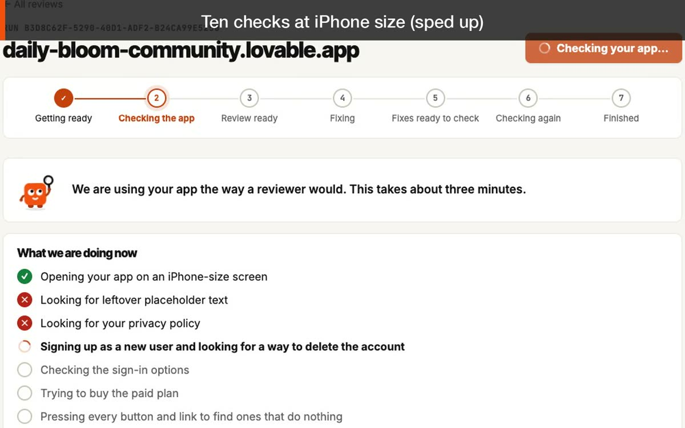
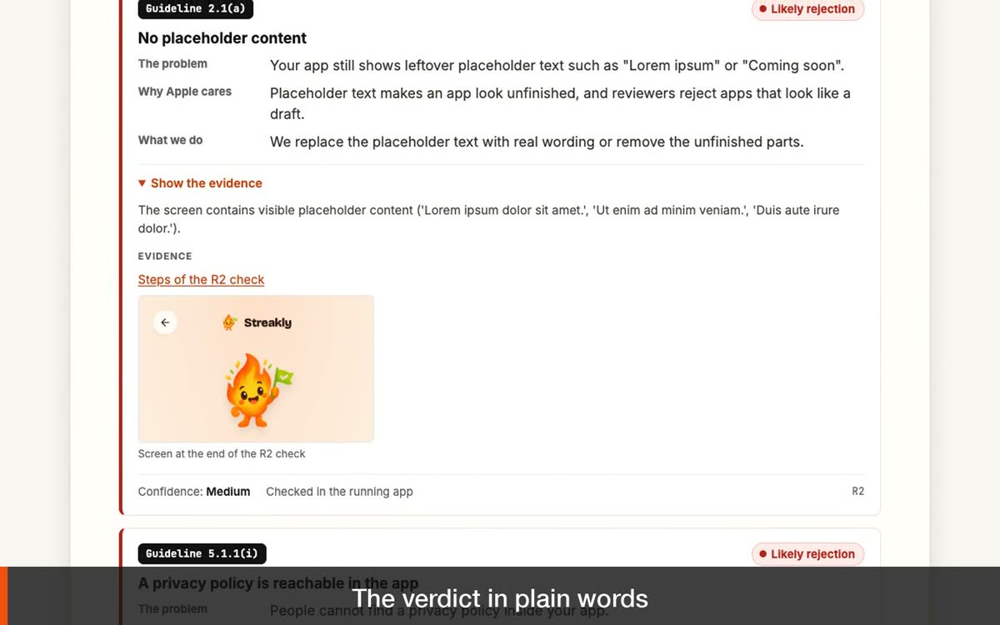
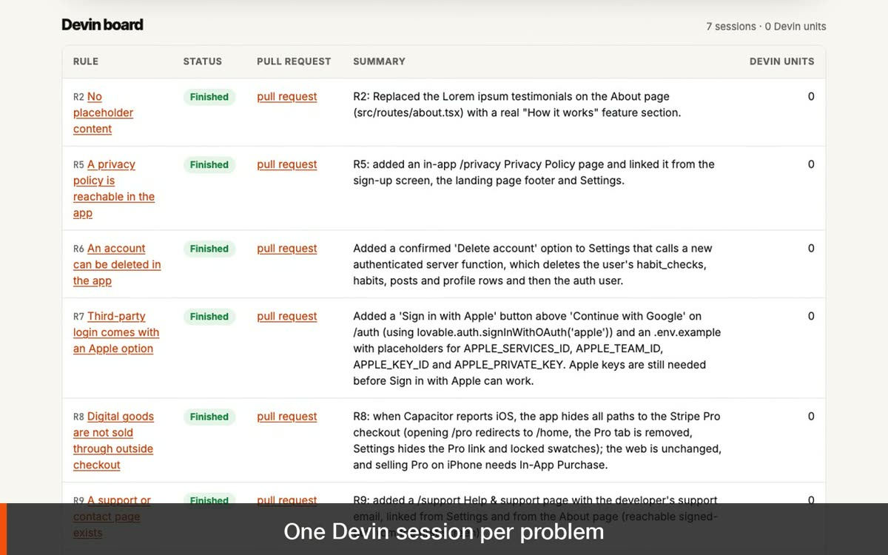
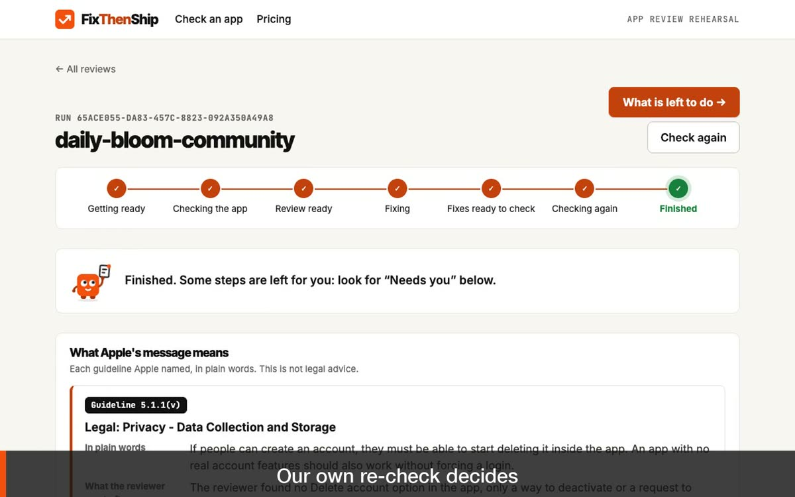
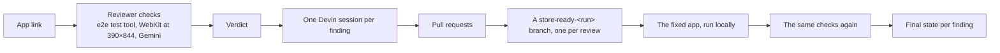

# FixThenShip

FixThenShip reviews an AI-built web app the way Apple's App Store reviewer would, starts Devin sessions to fix what it finds, and re-checks.

Website and a saved copy of a real review: https://fixthenship.netlify.app

Watch the 78-second demo: https://fixthenship.netlify.app/#watch (the file itself: https://fixthenship.netlify.app/demo.mp4)

Built in one day at Eurasian Hack London, 14 November 2026.

## Why

Apple reviewed 9,100,620 app submissions in 2025 and rejected 2,093,244 of them. 387,087 were approved only after a rejection (Apple, 2025 App Store Transparency Report). Apple says over 40% of unresolved issues fall under guideline 2.1, app completeness.

AI app builders made building an app easy. App Review is where people get stuck, and most of them have never read the guidelines.

## Who it is for

- **A first submission:** "I built an app and want it in the App Store."
- **An update to an app already in the store:** Apple reviews every update again.
- **An app Apple has already rejected:** paste Apple's message, and each guideline in it is explained in plain words and linked to our own finding.

All three start from the app's web link, the one the app builder gives on Publish. It is not an App Store link.

## What it looks like

Frames from the demo video, recorded on a real run on 14 November 2026.

| | |
|---|---|
|  |  |
| The review runs in a phone-size browser while you watch. | Apple's rejection message, explained in plain words. |
|  |  |
| One Devin session per problem, each a small pull request. | After our own re-check: fixed and verified, or needs you. |

## How it works

1. **Paste your app's web link.** Nothing else is needed to start. If Apple already rejected the app, paste Apple's message in the optional box too.
2. **We use the app the way a reviewer would.** We open it at iPhone size and run ten checks:
   - Opening your app on an iPhone-size screen
   - Looking for leftover placeholder text
   - Looking for your privacy policy
   - Signing up as a new user and looking for a way to delete the account
   - Checking the sign-in options
   - Trying to buy the paid plan
   - Pressing every button and link to find ones that do nothing
   - Checking that a reviewer can get past the sign-in
   - Looking for a support or contact page
   - Looking for the app builder's badge or default branding
3. **You get the verdict.** About two to three minutes later you see, in plain words, what would likely get the app rejected, with a screenshot of each problem. If you pasted Apple's message, "What Apple's message means" explains each guideline it names and links it to our finding.
4. **"Fix these for me".** This connects your GitHub repository and starts one Devin session per fixable finding. Each session opens one small pull request against a `store-ready-<run>` branch, one per review, so each run fixes on its own branch. When a pull request collides with fixes merged before it, it is sent back to the Devin session that wrote it to bring it up to date.
5. **We check again.** We merge those pull requests, run the fixed app and repeat the checks. The re-check reuses installed packages when the dependency list is the same. Every finding ends as fixed and verified, needs you, or still failing.
6. **Before you submit.** The ready page lists twenty things only the developer can see, such as the screenshots, the App Store Connect listing and the demo account.

## Why you can trust the result

- Devin does not mark its own work. Our own checks run again on the fixed app.
- A check that could not tell is reported as "could not check", never as a problem or a pass.
- A finding is green only when its fix was merged and our own check passed on the fixed app.
- Three kinds of finding never end green: Sign in with Apple, in-app purchase and the builder's badge. The first two need the developer's own Apple keys or purchase setup; the badge is added by the builder's hosting, not your code.
- The wording is always "likely" and "risk". Apple makes the decision.



## Run it

Requires Node 24.

```bash
npm install
```

Create `.env.local`:

```bash
GOOGLE_GENERATIVE_AI_API_KEY=   # Gemini, used by the app checks
MODEL=                          # model id for the app checks (default gemini-flash-latest)
MODEL_FALLBACKS=                # optional comma-separated models tried when MODEL does not answer
DEVIN_API_KEY=                  # starts and polls fix sessions
DEVIN_ORG_ID=                   # the Devin organization the fix sessions run in
DEVIN_MODE=                     # optional Devin mode for fix sessions
DEVIN_MAX_ACU=                  # optional limit per fix session (default 5)
GITHUB_TOKEN=                   # reads the repository, its pull requests, and merges into a `store-ready-<run>` branch, one per review
TEST_EMAIL_DOMAIN=              # optional domain for test accounts (default mailinator.com)
TEST_EMAIL=                     # optional fixed test account
TEST_PASSWORD=                  # optional password for test accounts
RUNS_DIR=                       # optional folder for runs (default ./runs)
```

A free Gemini key allows about ten reviews a day; a paid key costs a few cents per review.

```bash
npm run dev    # http://localhost:3000
npm test       # Vitest
```

Without keys the example run (`examples/example-run.json`) still opens at `/runs/example`.

To share a finished run as a static page that opens from disk or any static host:

```bash
node scripts/export-run.mjs <runId> <outDir>
```

## Rulebook

From `lib/rules.ts`.

| Id | Guideline | What is checked | Fixable |
|---|---|---|---|
| R1 | 2.1(a) | The app loads without errors | partly |
| R2 | 2.1(a) | No placeholder content | yes |
| R3 | 2.1 | No dead buttons or broken links | yes |
| R4 | 2.1(a) | The reviewer can get in | partly |
| R5 | 5.1.1(i) | A privacy policy is reachable in the app | yes |
| R6 | 5.1.1(v) | An account can be deleted in the app | yes |
| R7 | 4.8 | Third-party login comes with an Apple option | partly |
| R8 | 3.1.1 | Digital goods are not sold through outside checkout | partly |
| R9 | 1.5 | A support or contact page exists | yes |
| R10 | 4.2.6 | No app-builder badge or default branding | partly |
| R11 | 5.1.2(i) | No tracking or third-party AI calls before consent | partly |
| R12 | 1.2 | User content can be reported and blocked | yes |
| R13 | 4.2 | "Just a website" risk | no |

## What Apple's rulebook looks like from here

Apple's App Review Guidelines have 209 numbered rules (read on 14 November 2026). The ten checks cover 16 of them. Sorted by how a rule could be checked at all, about 53 could be checked by using the running app, 56 by reading the code, 16 from the store listing, 8 only in the native build, 30 can only be reminders, and 46 do not apply to small apps.

The largest gap is guideline 4.2, "a website in a wrapper", which no tool can pass or fail. It is on the checklist.

## Limits

- It tests the web build at iPhone size. Nothing is tested on a native build or a device.
- The app needs a web version that opens from a link.
- It covers about ten rules, not the whole App Review Guidelines.
- It has been run on one sample app.
- The mascot and the pricing page are in; payments are not.
- It predicts what a reviewer is likely to flag. Apple makes the decision.
- Test accounts use a public inbox (mailinator.com) by default, which is fine for demo apps only. Set `TEST_EMAIL_DOMAIN` to a domain whose mail you own for anything with real data.
- The re-check starts the fixed app with `npm run dev`, so the repository must have a `dev` script that starts it.
- The re-check installs and runs the reviewed app's code on this machine (with `--ignore-scripts` and a stripped environment). That is meant for apps you own; in production it must run inside an isolated sandbox (container or microVM) with no host secrets.
- The fix for a missing support page wrote the developer's own email address into the app as the support contact, taken from the repository's history, without asking. A real version must use a placeholder and leave the finding as "needs you" until the owner sets an address.

## Project layout

- `app/`: pages and API routes (Next.js).
- `components/`: the parts of the pages: verdict letter, finding cards, Devin board, ready page.
- `lib/`: the review pipeline, the code scan, fixes, the re-check, the rules and the run store.
- `checks/`: one reviewer check per rule, run in WebKit at iPhone size.
- `scripts/`: `export-run.mjs`, which saves a finished run as a static page.
- `examples/`: an example run that opens without any keys.
- `tests/`: Vitest tests.

## How this was built

Built on 14 November 2026 between 10:00 and 14:45 at Eurasian Hack London. The design and the plan were written the day before, as the rules allow; no code existed before 10:00.

- **Devin (Cognition) wrote the product.** 23 build sessions, started through the Devin API from written briefs that each own a set of files, up to six at once on one branch. Devin is also the fixer inside the product: one session per finding, seven at once on the sample app.
- **Claude Code (Anthropic) wrote the design, the plan and every brief, reviewed every push, ran every check on a real app, and made small fixes itself.** Each of those is in `BUILDLOG.md`. Separate Claude Code sessions built the marketing website, the mascot and the demo video.
- **Two independent reviews** of the code, one by a Devin session on its strongest mode and one by a panel of Claude agents with a skeptic for each finding, produced 39 confirmed findings. Six Devin sessions fixed them within the hour.
- **Lovable built the sample app** that the product reviews, deliberately left with the problems a first-time builder leaves.
- **The e2e test tool** runs the reviewer checks in a phone-size browser, with Google's Gemini judging the plain-English steps.
- **Research** for the checklist and the rejection decoder: Apple's App Review Guidelines read in full on the day (209 numbered rules), with a second pass that checked every guideline number used in the product against Apple's page.

What went wrong is in `BUILDLOG.md` too: checks that passed Devin's own tests and failed on a real app, two security problems that an independent check caught, a re-check that was wrong twice, a fix that hid Lovable's badge with CSS, and a free model key that ran out at noon.
