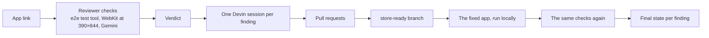

# FixThenShip

FixThenShip reviews an AI-built web app the way Apple's App Store reviewer would, starts Devin sessions to fix what it finds, and re-checks.

Built in one day at Eurasian Hack London, 14 November 2026.

## Why

Apple reviewed 9,100,620 app submissions in 2025 and rejected 2,093,244 of them. 387,087 were approved only after a rejection (Apple, 2025 App Store Transparency Report). Apple says over 40% of unresolved issues fall under guideline 2.1, app completeness.

AI app builders made building an app easy. App Review is where people get stuck, and most of them have never read the guidelines.

## How it works

1. **Paste your app's link.** Nothing else is needed to start.
2. **We use the app the way a reviewer would.** We open it at iPhone size and run ten checks:
   - Opening your app on an iPhone-size screen
   - Looking for leftover placeholder text
   - Looking for your privacy policy
   - Signing up as a new user and looking for a way to delete the account
   - Checking the sign-in options
   - Trying to buy the paid plan
   - Pressing every button and link to find ones that do nothing
   - Checking that a reviewer can get past the sign-in
   - Looking for a support or contact page
   - Looking for the app builder's badge or default branding
3. **You get the verdict.** About two to three minutes later you see, in plain words, what would likely get the app rejected, with a screenshot of each problem.
4. **"Fix these for me".** This connects your GitHub repository and starts one Devin session per fixable finding. Each session opens one small pull request against a `store-ready` branch.
5. **We check again.** We merge those pull requests, run the fixed app and repeat the checks. Every finding ends as fixed and verified, needs you, or still failing.

## Why you can trust the result

- Devin does not mark its own work. Our own checks run again on the fixed app.
- A check that could not tell is reported as not checked, never as a problem.
- Two rules can never end green: Sign in with Apple and in-app purchase. They need the developer's own Apple keys or purchase setup.
- The wording is always "likely" and "risk". Apple makes the decision.



## Run it

Requires Node 24.

```bash
npm install
```

Create `.env.local`:

```bash
GOOGLE_GENERATIVE_AI_API_KEY=   # Gemini, used by the app checks
MODEL=                          # model id for the app checks (default gemini-flash-latest)
DEVIN_API_KEY=                  # starts and polls fix sessions
DEVIN_ORG_ID=
DEVIN_MODE=                     # optional Devin mode for fix sessions
DEVIN_MAX_ACU=                  # optional limit per fix session (default 5)
GITHUB_TOKEN=                   # reads the repository, its pull requests, and merges into store-ready
TEST_EMAIL_DOMAIN=              # optional domain for test accounts (default mailinator.com)
TEST_EMAIL=                     # optional fixed test account
TEST_PASSWORD=
RUNS_DIR=                       # optional folder for runs (default ./runs)
```

```bash
npm run dev    # http://localhost:3000
npm test       # Vitest
```

Without keys the example run (`examples/example-run.json`) still opens at `/runs/example`.

To share a finished run as a static page that opens from disk or any static host:

```bash
node scripts/export-run.mjs <runId> <outDir>
```

## Rulebook

From `lib/rules.ts`.

| Id | Guideline | What is checked | Fixable |
|---|---|---|---|
| R1 | 2.1(a) | The app loads without errors | partly |
| R2 | 2.1(a) | No placeholder content | yes |
| R3 | 2.1 | No dead buttons or broken links | yes |
| R4 | 2.1(a) | The reviewer can get in | partly |
| R5 | 5.1.1(i) | A privacy policy is reachable in the app | yes |
| R6 | 5.1.1(v) | An account can be deleted in the app | yes |
| R7 | 4.8 | Third-party login comes with an Apple option | partly |
| R8 | 3.1.1 | Digital goods are not sold through outside checkout | partly |
| R9 | 1.5 | A support or contact page exists | yes |
| R10 | 4.2.6 | No app-builder badge or default branding | yes |
| R11 | 5.1.2(i) | No tracking or third-party AI calls before consent | partly |
| R12 | 1.2 | User content can be reported and blocked | yes |
| R13 | 4.2 | "Just a website" risk | no |

## Limits

- It tests the web build at iPhone size, not a native build on a device.
- The app needs a web version that opens from a link.
- It covers about ten rules, not the whole App Review Guidelines.
- It predicts what a reviewer is likely to flag. Apple makes the decision.
- Test accounts use a public inbox (mailinator.com) by default, which is fine for demo apps only. Set `TEST_EMAIL_DOMAIN` to a domain whose mail you own for anything with real data.
- The re-check starts the fixed app with `npm run dev`, so the repository must have a `dev` script that starts it.
- The re-check installs and runs the reviewed app's code on this machine (with `--ignore-scripts` and a stripped environment). That is meant for apps you own; in production it must run inside an isolated sandbox (container or microVM) with no host secrets.

## Project layout

- `app/`: pages and API routes (Next.js).
- `components/`: the parts of the pages: verdict letter, finding cards, Devin board, ready page.
- `lib/`: the review pipeline, the code scan, fixes, the re-check, the rules and the run store.
- `checks/`: one reviewer check per rule, run in WebKit at iPhone size.
- `scripts/`: `export-run.mjs`, which saves a finished run as a static page.
- `examples/`: an example run that opens without any keys.
- `tests/`: Vitest tests.

## How this was built

<filled in at submission from BUILDLOG.md>
